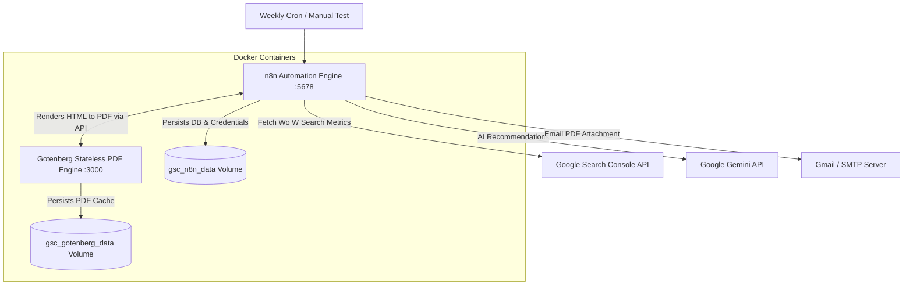

# 📊 Google Search Console (GSC) Weekly SEO Report — n8n & Gotenberg Workflow

An automated n8n workflow that fetches Google Search Console performance data, calculates week-over-week growth, categorizes search intent and brand terms, enriches insights with **Google Gemini AI**, converts HTML reports into multi-page PDF documents via **Gotenberg**, and delivers them directly to your email.

---

## 🏗️ Stack Architecture



---

## 📁 Included Files

- 📄 [`gsc-weekly-seo-report.json`](file:///home/cleaff/n8nworkflow/GoogleSearchConsole/gsc-weekly-seo-report.json): Sanitized n8n workflow ready for import.
- 🐳 [`docker-compose.yml`](file:///home/cleaff/n8nworkflow/GoogleSearchConsole/docker-compose.yml): Runs n8n + Gotenberg containers with persistent volumes.
- ⚙️ [`.env.example`](file:///home/cleaff/n8nworkflow/GoogleSearchConsole/.env.example): Environment variable configuration template.
- 📝 [`.env`](file:///home/cleaff/n8nworkflow/GoogleSearchConsole/.env): Active local configuration with auto-generated encryption key.
- 📥 [**seo-report-2026-10-04 (2).pdf**](file:///home/cleaff/n8nworkflow/GoogleSearchConsole/seo-report-2026-10-04%20%282%29.pdf): Pre-generated sample output PDF report.

---

## ⚡ Key Features

1. **Week-over-Week Metrics**: Total Clicks, Impressions, CTR, and Average Position comparisons.
2. **Brand vs. Non-Brand Classification**: Distinguishes brand navigation queries from generic search discovery.
3. **Search Intent Funnel**: Categorizes queries into Commercial, Informational, and Navigational buckets.
4. **Striking Distance Opportunities**: Identifies keywords ranking between positions 4–30 with high impression volume.
5. **Cannibalization Warning**: Flags multiple pages competing for the exact same search query.
6. **Google Gemini AI Recommendations**: Generates tailored tactical advice for content and technical optimization.
7. **Gotenberg HTML-to-PDF Converter**: Microservice that converts responsive HTML templates into clean PDFs.
8. **Automated PDF Email Delivery**: Delivers PDF reports directly to your configured email list.

---

## 🛠️ Quick Start & Setup Guide

### Step 1: Navigate to Folder & Create `.env`

```bash
cd GoogleSearchConsole

# Copy template if .env does not exist
cp .env.example .env

# Generate a secure 32-byte encryption key
openssl rand -hex 32
```

Paste your generated 64-character key into `.env`:
```env
N8N_ENCRYPTION_KEY=your_generated_hex_key_here
N8N_PORT=5678
GOTENBERG_PORT=3000
GENERIC_TIMEZONE=Asia/Kolkata
```

---

### Step 2: Start Containers with Docker Compose

```bash
docker compose up -d
```

Verify running services:
```bash
docker compose ps
```

Access services:
- **n8n UI**: `http://localhost:5678`
- **Gotenberg API Health**: `http://localhost:3000/health`

---

### Step 3: Configure the `Config` Node in n8n

Import `gsc-weekly-seo-report.json` into n8n. Double-click the **Config** code node and update the JS configuration block:

```javascript
const CONFIG = {
  // Domain property ('sc-domain:example.com') OR URL-prefix ('https://www.example.com/')
  siteUrl: 'sc-domain:yourdomain.com',

  // Recipient email addresses (comma-separated for multiple)
  reportEmail: 'your-email@example.com',

  // Brand keywords to separate brand vs non-brand traffic
  brandTerms: ['yourbrand', 'brandname'],

  // Commercial intent keywords
  commercialTerms: ['service', 'pricing', 'cost', 'consulting', 'agency', 'hire', 'quote'],

  // Informational intent keywords
  informationalTerms: ['what', 'how', 'why', 'guide', 'tutorial', 'vs', 'difference', 'best practices'],

  // Manual topic clusters (optional). Leave empty {} for automatic grouping
  topics: {
    'AI & Tech': ['ai', 'agent', 'software'],
    'SEO': ['seo', 'ranking', 'traffic']
  },

  // GSC data lag offset in days (GSC lags ~2-3 days)
  lagDays: 3,

  // Comparison period length in days
  periodDays: 7,

  // Minimum impressions filter (ignores low-volume noise)
  minImpressions: 5
};
```

---

## 🔐 Credentials Setup in n8n

### 1. Google Search Console API (`googleOAuth2Api`)
- In n8n UI, go to **Credentials** → **New** → **Google OAuth2 API**.
- Add OAuth scope: `https://www.googleapis.com/auth/webmasters.readonly`.
- Attach credential to all `GSC *` HTTP Request nodes.

### 2. Google Gemini API (`httpHeaderAuth`)
- Obtain an API key from [Google AI Studio](https://aistudio.google.com/app/apikey).
- Create a **Header Auth** credential in n8n:
  - **Name**: `x-goog-api-key`
  - **Value**: `YOUR_GEMINI_API_KEY`
- Attach to the **Gemini Recommendations** node.

### 3. Gotenberg PDF Service
- Gotenberg runs as a container microservice on `http://gotenberg:3000/forms/chromium/convert/html`.
- Parameters sent by n8n:
  - `files`: `index.html`
  - `printBackground`: `true`
  - `paperWidth`: `8.27` (A4)
  - `paperHeight`: `11.7` (A4)

### 4. Gmail / SMTP (`gmailOAuth2`)
- Create a **Gmail OAuth2** credential in n8n.
- Attach to **Send Report (Gmail)** and **Failure Alert (Gmail)** nodes.

---

## 🧪 Testing the Workflow

1. In n8n, open the imported workflow.
2. Click **Execute Workflow** on the **Manual Test** trigger node.
3. Check execution steps: `Config` → `GSC Queries` → `Analyze` → `Gemini Recommendations` → `Build HTML` → `Gotenberg PDF` → `Send Report (Gmail)`.
4. Open your email inbox to view the attached PDF report!
